# Microservices 12 Patterns

A small Contoso e-commerce system that shows **12 microservices patterns working for real**.
Each pattern gets its own page with an explanation, when *not* to use it, and a live demo you
can click.

> **Status: complete.** All 12 patterns are live, each with a working demo, locally and in one
> real Azure run (issue #11): provision, Deploy through GitHub Actions with OIDC, smoke tests,
> screenshots, teardown. The foundation is copied from
> [Azure-Ecommerce-Monolith-Microservices-Migration](https://github.com/MAOFILHO/Azure-Ecommerce-Monolith-Microservices-Migration).
> See [docs/PLAN.md](docs/PLAN.md) and the [M3b issues](https://github.com/MAOFILHO/Microservices-12-Patterns/issues).

## The 12 patterns

| # | Pattern | What it does | Status |
|---|---|---|---|
| 1 | Database per Service | Gives each service its own database | **Live (M1)** |
| 2 | Bounded Context | Splits one large domain into clear business domains | **Live (M1)** |
| 3 | CI-CD Pipeline | Builds, tests and deploys every service automatically | **Live (M3b)** |
| 4 | Circuit Breaker | Stops calls to a failing service to prevent more failures | **Live (M2)** |
| 5 | API Gateway | Routes client requests to the right service | **Live (M1)** |
| 6 | Observability | Collects logs, metrics and traces from every service | **Live (M1)** |
| 7 | Event-Driven Architecture | Services communicate by publishing and consuming events | **Live (M3a)** |
| 8 | Saga Pattern | Coordinates distributed transactions and rolls back failures safely | **Live (M3a)** |
| 9 | Containerization | Packages each service with all its dependencies | **Live (M3a)** |
| 10 | Stateless Services | Stores session data outside the service | **Live (M2)** |
| 11 | Contract Testing | Checks that APIs stay compatible across services | **Live (M2)** |
| 12 | Service Discovery | Finds service instances automatically at runtime | **Live (M2)** |

## Architecture today

```
Browser → API gateway ──┬──► user        → user_db      (signs login tokens)
  (checks tokens,       ├──► catalog     → catalog_db
   request IDs,         ├──► order ×2    → order_db     checkout saga: price → hold stock →
   tracing, metrics,    │                               charge (circuit breaker) → confirm
   aggregation,         ├──► payment     → payment_db
   failover)            └──► inventory   → inventory_db

order_db outbox ──relay──► Redis Stream "shop.events" ──► inventory (sells the held stock)
Every service heartbeats into the registry (:8500); callers look each other up there.
```

- **5 Flask services** (`services/`), each with its own database: SQLite locally, one logical
  MySQL database each in Azure. Locally the order service runs as 2 replicas.
- **FastAPI gateway** (`gateway/`): the only thing the browser talks to. Routes `/api/shop/*` to
  the owning service, adds request IDs, aggregates `/api/order-summary`, serves the demo endpoints.
- **`shop_common`** (`shared/`): OpenTelemetry tracing, JSON logs with trace IDs, Prometheus
  metrics, the `/health/db`, `/debug/spans`, `/metrics` endpoints, token checks and the discovery client.
- **Service registry** (`registry/`): about 90 lines of FastAPI. Local only; Azure uses Container Apps DNS.
- **Contracts** (`contracts/pacts/`): the Pact files the order service needs payment, catalog and inventory to honour.
- **Redis** (Homebrew `redis-server`, in memory, port 6390): the event bus. `make run` starts and stops it.
- **Dockerfiles**: one per service plus gateway and registry, multi-stage, non-root, built only in
  the cloud or CI for `linux/amd64`.
- **React + TypeScript** frontend (`frontend/`) with a page per pattern.

Still to come (M3b): path-filtered CI with a manual Deploy workflow (OIDC), and a real Azure run.

## The live demos

### 1. Database per Service
Each service reports the database it owns. Then the order service tries to read the catalog's
`product` table through its own connection, and the database refuses: `no such table: product`.

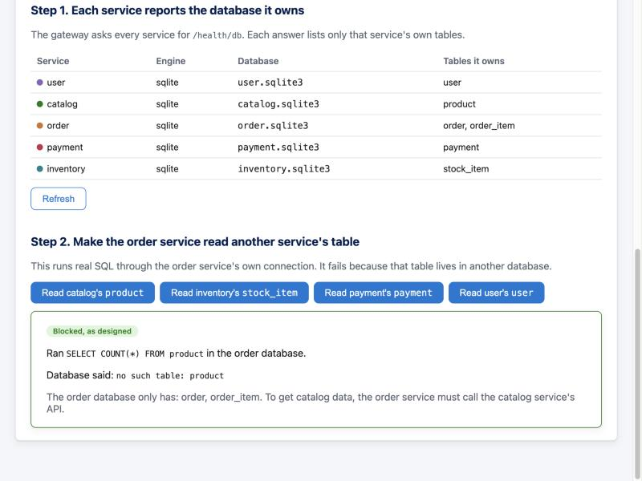

### 2. Bounded Context
A context map of the 5 business contexts, and one product as two contexts see it: Catalog knows
its name and price, Inventory knows how many are on hand.

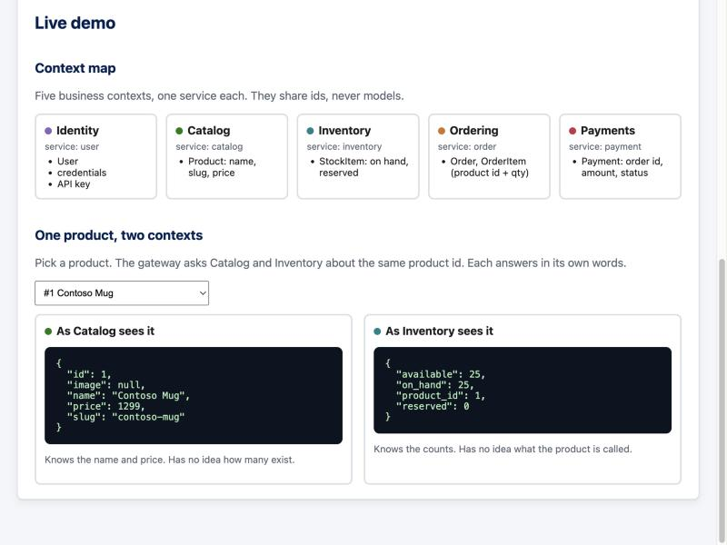

### 5. API Gateway
One browser call to `/api/order-summary` becomes 4 service calls. The page shows each call, its
status and timing, and the one request ID forwarded to all of them.

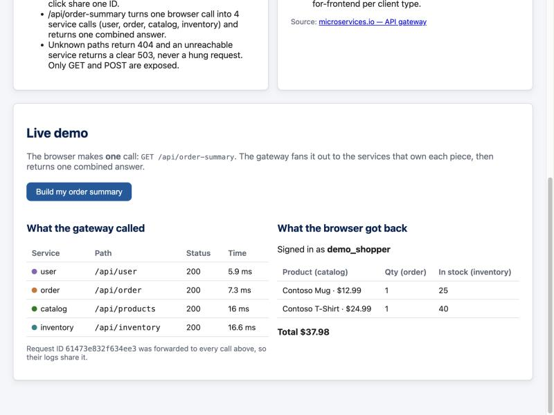

### 6. Observability
One click, traced through every process: 25 spans across 5 processes, including each service's
database queries, drawn as a waterfall. Metrics per service come from each `/metrics` endpoint.


### 3. CI-CD Pipeline
Which commit each running service was built from, compared with the latest commit on main, and
the latest CI and Deploy runs, read from GitHub. Locally every process is a "local build"; in Azure
each image carries its commit, so a service that is behind main shows up at once.

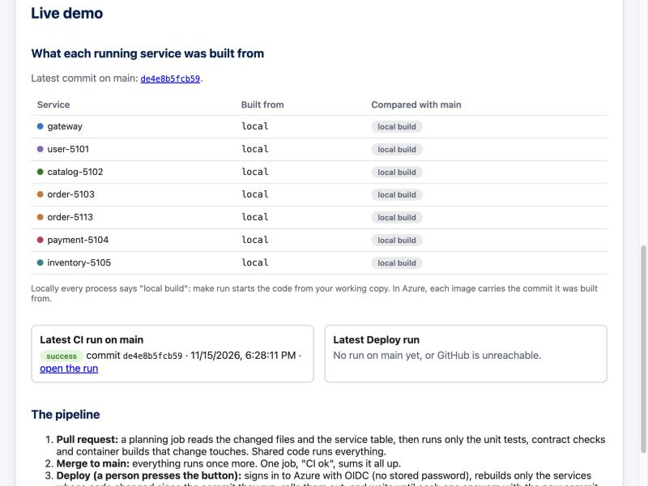

### 4. Circuit Breaker
Switch payment to slow and send 10 calls. Each order replica's breaker opens after 3 failures.
A real failure took 2,215 ms; a call the open breaker stopped took 0 ms. After 15 s with payment
healthy again, both breakers close.

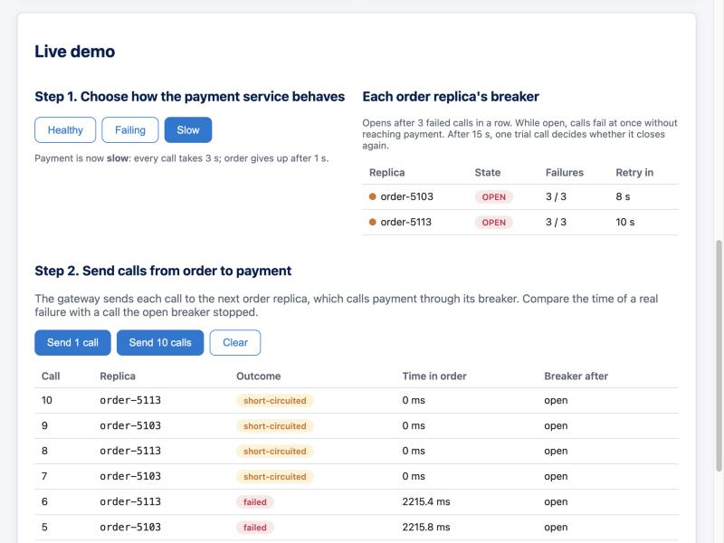

### 10. Stateless Services
Your login is a signed token, readable by anyone, signed only by the user service. Ask for your
cart 6 times: both order replicas answer. Stop one: all 6 calls still succeed, same cart, still
logged in.

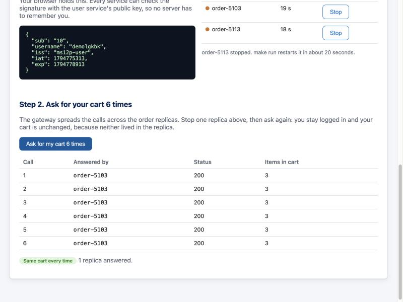

### 11. Contract Testing
The order service's contracts with payment and catalog, read from the committed Pact files, and
the real CI output when payment renames one field the order service relies on.

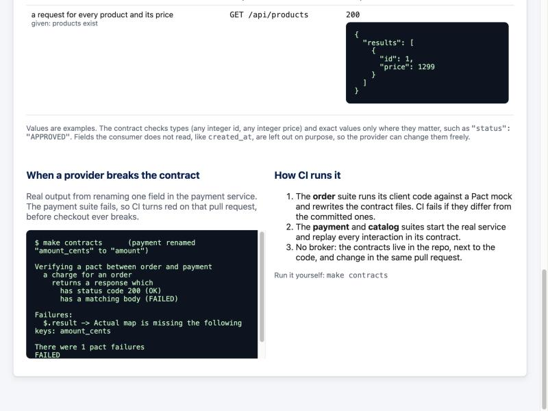

### 12. Service Discovery
The live registry. Stop an instance: its heartbeat stops, the registry expires it after 10 s, and
`make run` restarts it 20 s later, when it registers again.

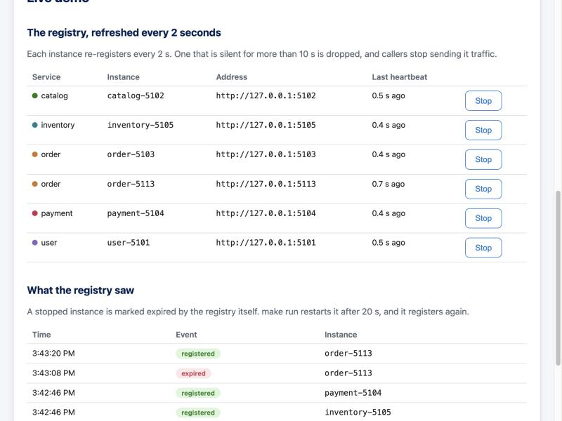

### 7. Event-Driven Architecture
Disconnect the bus and buy a mug: OrderConfirmed waits in the order service's outbox, and the mug
stays held in inventory. Reconnect: the event goes out and inventory turns the hold into a sale.

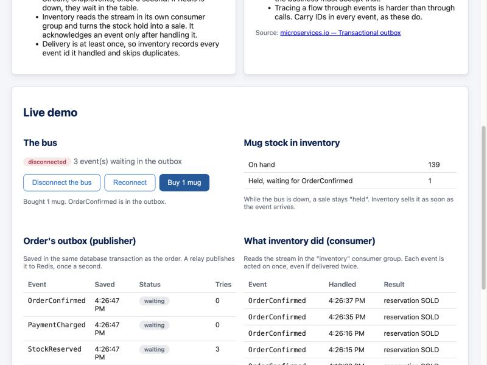

### 8. Saga
Buy 2 mugs with "make the bank decline the card" ticked. The saga prices the cart, holds the stock,
the charge fails, and it releases the stock. Stock ends exactly where it started; the cart is kept.

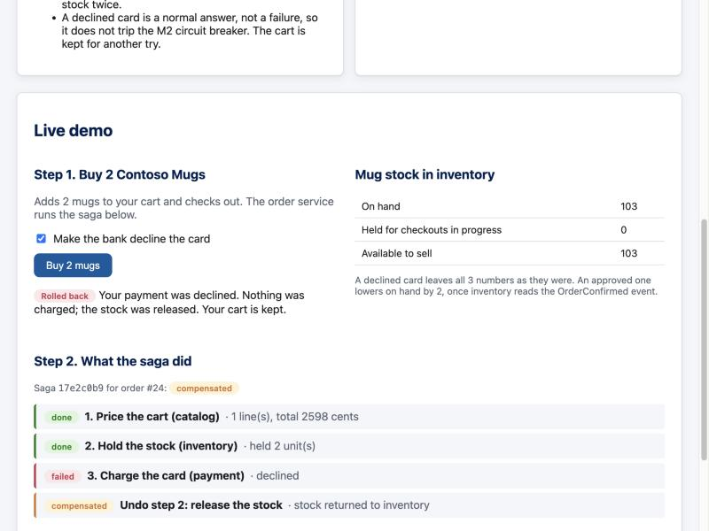

### 9. Containerization
How each process runs (uid, container or not, platform, build). Locally they are plain processes;
CI builds and runs every image for linux/amd64 and fails any that runs as root.

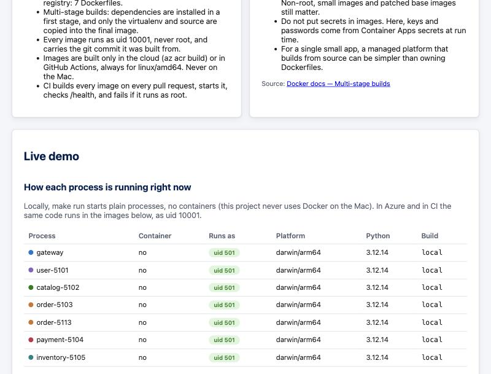

## Run locally (no Docker)

```bash
brew install redis   # once: the event bus (patterns 7 and 8)
make setup    # one venv per service + gateway, shop_common, frontend packages
make run      # frontend :5273, gateway :8100, registry :8500, Redis :6390
make test     # unit tests, each suite in its own venv
make contracts  # Pact: order writes its contracts, payment and catalog verify them
make smoke    # end-to-end checks against the running stack
```

Optional: set `OTEL_EXPORTER_OTLP_ENDPOINT` to also send spans to an OpenTelemetry viewer or
collector. Without it, traces stay in each process's memory and the Observability page draws them.

## Cloud

Azure Container Apps (one app per service plus the gateway, all scale-to-zero; Redis as an
always-on internal bus) + MySQL Flexible Server. About $0.21 for an 8-hour session; see
[cost_estimate.md](cost_estimate.md). In Azure, discovery uses Container Apps DNS (no registry), and
the demo switches stay off. Redis is reachable only from apps inside the environment and has no
password, which is fine for a demo where every app is ours.

### The Azure run (#11)
`make provision` built 6 images in the cloud (67-69 MB each, tagged with the commit), deployed them
plus Redis, and created the $25 budget alert. The Azure smoke tests
(`tests/smoke/test_post_provision_azure.py`) passed 4 of 4: a sale settled through Redis, demo
switches answered 403, every container ran as uid 10001 on the deployed commit, and the CI-CD page
saw every service on main. The Deploy button then signed in with OIDC and correctly rebuilt
nothing. Everything was removed with `make teardown` the same evening.

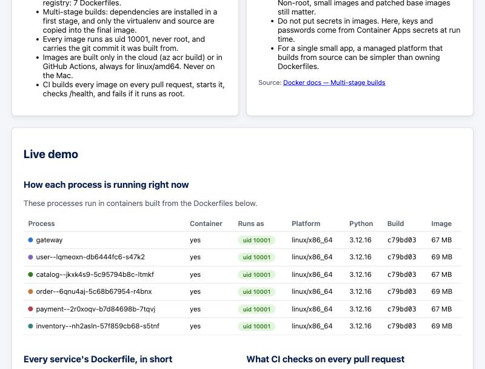

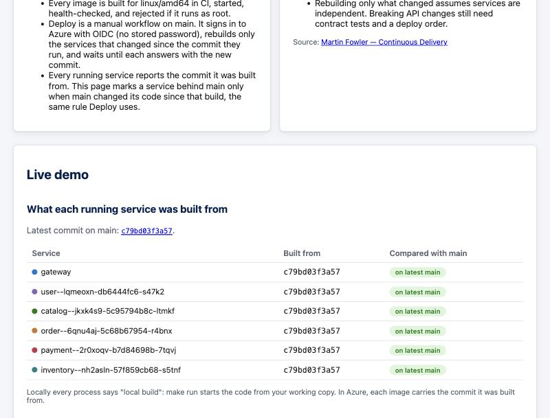

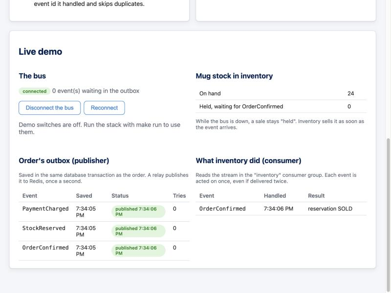

Lessons from the run: GitHub now presents an OIDC subject with account and repo ids, so the
identity trusts both forms (PR #14); `make verify` can time out while Azure removes an empty
Container Apps environment, which takes longer than everything else and bills nothing.

```bash
make github-identity   # once: the Azure identity the Deploy workflow uses (OIDC, no secret)
make provision BUDGET_EMAIL=you@example.com   # everything, images tagged with the current commit
# then GitHub → Actions → Deploy → Run workflow: rebuilds only the services that changed
make teardown && make verify                    # remove everything, then prove nothing is left
```

### CI-CD (pattern 3)
- **CI on every pull request** runs only what the change touches (`scripts/ci_changes.py`, driven
  by the service table): a change to one service runs its tests and its image; a change to shared
  code, CI or the service table runs everything. Pushes to main run everything.
- **Deploy** is a manual workflow on main. It signs in to Azure with OIDC (no password stored),
  rebuilds only services whose code changed since the commit they run, tags each image with the
  commit, and records each image's size.
