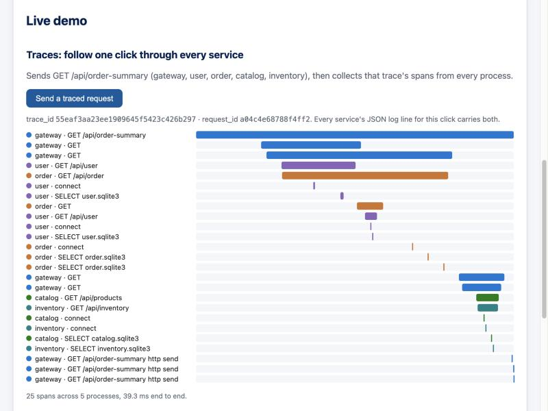

# Microservices 12 Patterns

A small Contoso e-commerce system that shows **12 microservices patterns working for real**.
Each pattern gets its own page with an explanation, when *not* to use it, and a live demo you
can click.

> **Status: M1, foundation.** 4 of 12 patterns are live: Database per Service, Bounded Context,
> API Gateway and Observability. The foundation is copied from
> [Azure-Ecommerce-Monolith-Microservices-Migration](https://github.com/MAOFILHO/Azure-Ecommerce-Monolith-Microservices-Migration).
> The rest arrive in milestones M2 and M3. See [docs/PLAN.md](docs/PLAN.md).

## The 12 patterns

| # | Pattern | What it does | Status |
|---|---|---|---|
| 1 | Database per Service | Gives each service its own database | **Live (M1)** |
| 2 | Bounded Context | Splits one large domain into clear business domains | **Live (M1)** |
| 3 | CI-CD Pipeline | Builds, tests and deploys every service automatically | M3 |
| 4 | Circuit Breaker | Stops calls to a failing service to prevent more failures | M2 |
| 5 | API Gateway | Routes client requests to the right service | **Live (M1)** |
| 6 | Observability | Collects logs, metrics and traces from every service | **Live (M1)** |
| 7 | Event-Driven Architecture | Services communicate by publishing and consuming events | M3 |
| 8 | Saga Pattern | Coordinates distributed transactions and rolls back failures safely | M3 |
| 9 | Containerization | Packages each service with all its dependencies | M3 |
| 10 | Stateless Services | Stores session data outside the service | M2 |
| 11 | Contract Testing | Checks that APIs stay compatible across services | M2 |
| 12 | Service Discovery | Finds service instances automatically at runtime | M2 |

## Architecture today

```
Browser → API gateway ──┬──► user       → user_db
  (request IDs,         ├──► catalog    → catalog_db
   tracing, metrics,    ├──► order      → order_db ──HTTP──► user (validates the caller)
   aggregation)         ├──► payment    → payment_db
                        └──► inventory  → inventory_db
```

- **5 Flask services** (`services/`), each with its own database: SQLite locally, one logical
  MySQL database each in Azure.
- **FastAPI gateway** (`gateway/`): the only thing the browser talks to. Routes `/api/shop/*` to
  the owning service, adds request IDs, aggregates `/api/order-summary`, serves the demo endpoints.
- **`shop_common`** (`shared/`): OpenTelemetry tracing, JSON logs with trace IDs, Prometheus
  metrics, and the `/health/db`, `/debug/spans`, `/metrics` endpoints every service exposes.
- **React + TypeScript** frontend (`frontend/`) with a page per pattern.

Still to come: service registry, JWT and replicas, circuit breaker, Pact contract tests (M2);
Redis Streams events with an outbox, checkout saga, hardened containers, deploy pipeline (M3).

## The live demos

### 1. Database per Service
Each service reports the database it owns. Then the order service tries to read the catalog's
`product` table through its own connection, and the database refuses: `no such table: product`.


### 2. Bounded Context
A context map of the 5 business contexts, and one product as two contexts see it: Catalog knows
its name and price, Inventory knows how many are on hand.


### 5. API Gateway
One browser call to `/api/order-summary` becomes 4 service calls. The page shows each call, its
status and timing, and the one request ID forwarded to all of them.


### 6. Observability
One click, traced through every process: 25 spans across 5 processes, including each service's
database queries, drawn as a waterfall. Metrics per service come from each `/metrics` endpoint.



## Run locally (no Docker)

```bash
make setup    # one venv per service + gateway, shop_common, frontend packages
make run      # frontend http://127.0.0.1:5273, gateway http://127.0.0.1:8100
make test     # unit tests, each suite in its own venv
make smoke    # end-to-end checks against the running stack
```

Optional: set `OTEL_EXPORTER_OTLP_ENDPOINT` to also send spans to an OpenTelemetry viewer or
collector. Without it, traces stay in each process's memory and the Observability page draws them.

## Cloud

Azure Container Apps (one app per service plus the gateway, all scale-to-zero) + MySQL Flexible
Server, provisioned with `make provision` and removed with `make teardown`. About $0.21 for an
8-hour session. See [cost_estimate.md](cost_estimate.md). Nothing from M1 has been deployed yet.
